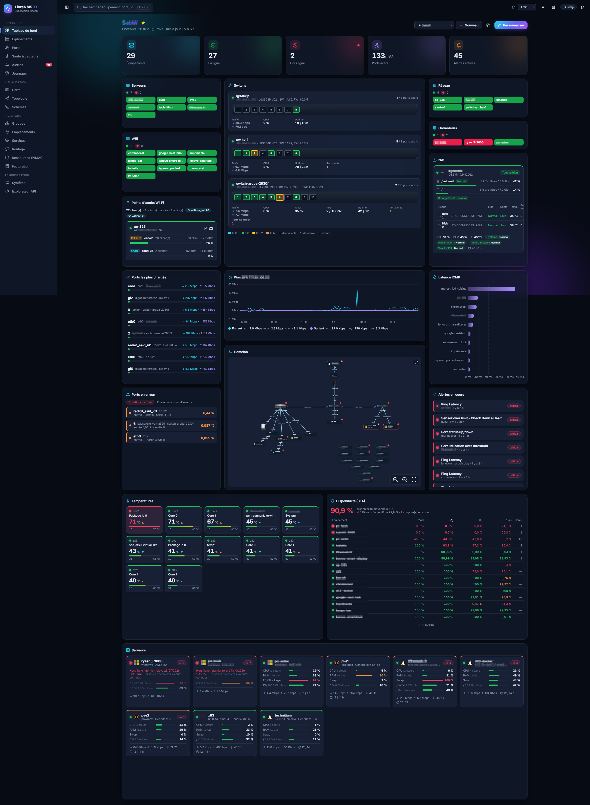
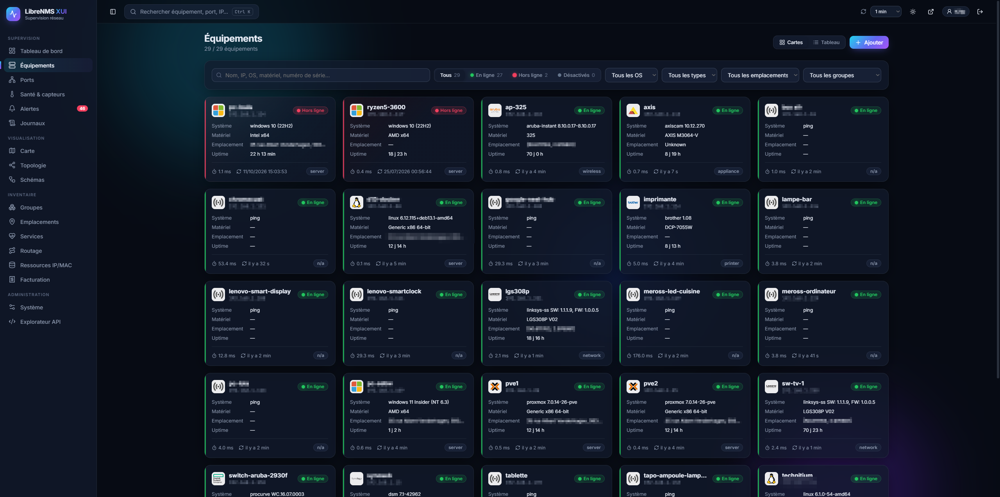
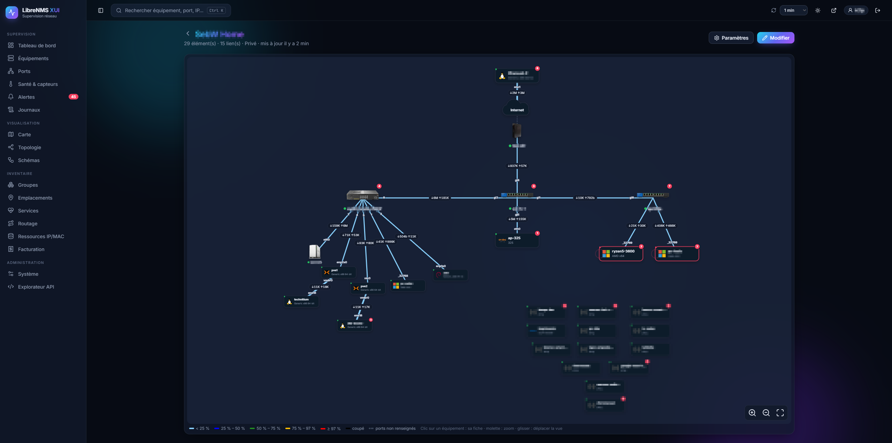
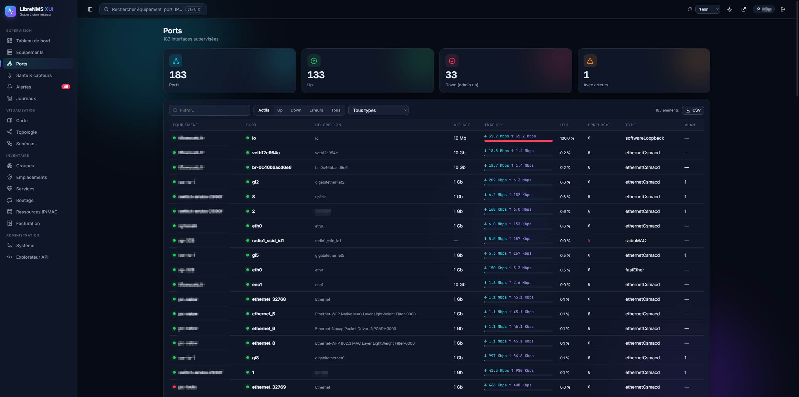
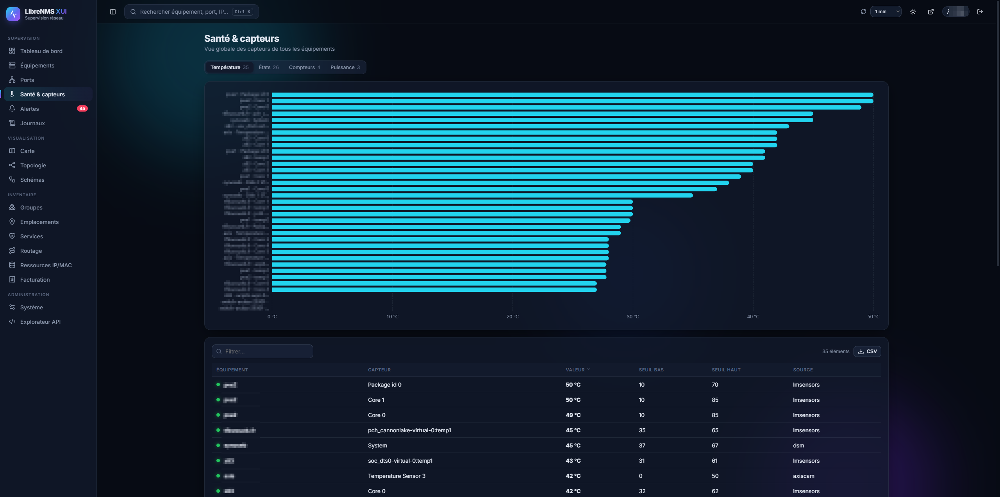
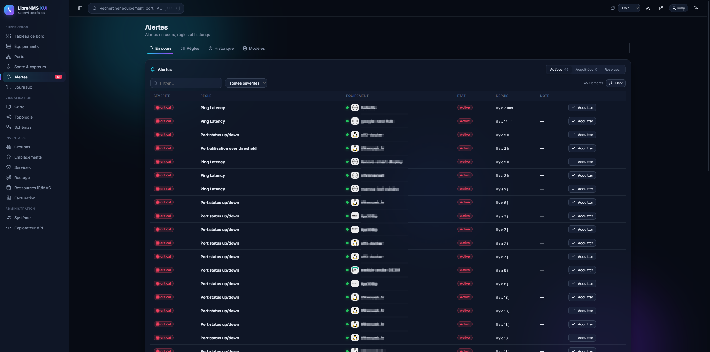
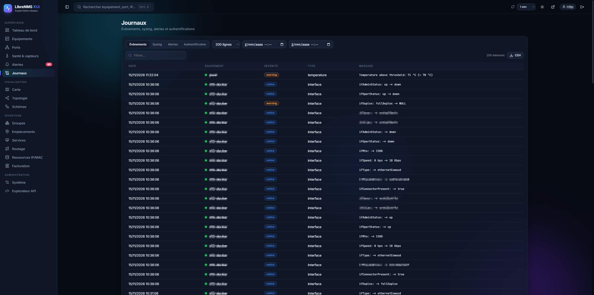
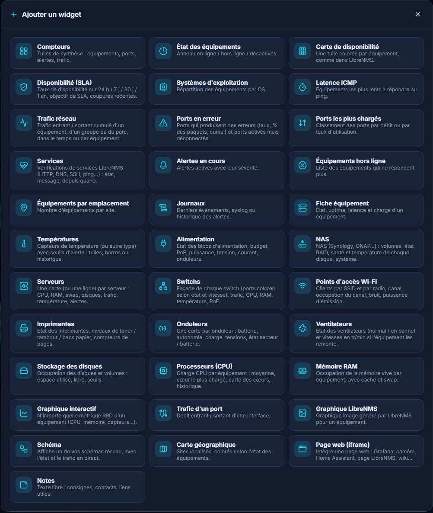

# LibreNMS XUI

[Français](README.md) · **English**

**A modern web interface for [LibreNMS](https://www.librenms.org/).**

LibreNMS keeps doing what it does well (discovery, SNMP polling, alerting); XUI adds a fast, clean interface
on top of it: customizable dashboards, interactive graphs, live network diagrams, dark theme… It relies on
the **LibreNMS API** and its **RRD files** (mounted read-only): nothing to change or install in LibreNMS. Two
optional exceptions: a port's "Real time" graph polls the device over SNMP, using the credentials from the API; the
list of deleted ports is read from the LibreNMS MySQL database (read-only account), since the API does not expose them;
this database is also used for CPU / memory / storage with LibreNMS < 26.7.

> The interface is available in **English and French** (FR / EN button in the top bar; defaults to the browser language).
> Screenshots show the French version.



## Overview

| | |
|---|---|
| **Devices**: cards or table, filters, SNMP / ICMP onboarding<br> | **Network diagrams**: built-in editor, links colored by load or throughput<br> |
| **Ports**: traffic, utilization and errors for every interface<br> | **Health & sensors**: temperatures, states, counters, power<br> |
| **Alerts**: active alerts, acknowledgement, rules, history<br> | **Logs**: events, syslog, alerts, authentication<br> |

<p align="center"><br><em>30+ widgets to build your own dashboards</em></p>

## Highlights

- **Tailor-made dashboards**: drag-and-drop, resizable widgets (servers, switches with front-panel port view,
  NAS, Wi-Fi, UPS, printers, temperatures, availability / SLA, traffic, diagrams, racks…), several dashboards per user,
  sharing, export / import.
- **Interactive graphs** drawn from the RRD files: zoom, hover, ranges from 1 h to 1 year, statistics.
- **Live network diagrams**: device status, alerts, throughput; links colored by load or throughput (custom
  colors), traffic graph and one-click access to ports, custom images, elements that are not in LibreNMS
  (ISP router, camera…), background (floor plan, rack photo), generation from LLDP.
- **Network racks**: one or more racks per room, LibreNMS devices and passive items (patch panels, PDUs,
  shelves…) placed by U with drag-and-drop, front panels with real port status, network and power port-to-port
  cabling (including between racks and to ping-only devices) with live status and traffic, exportable cable list.
- **Complete device page**: overview with photos, ports, health, inventory, CDP/LLDP neighbours, network,
  routing, services, alerts, logs, availability, Oxidized config, management.
- **Alert details**: timeline (first detection, duration), rule conditions in plain words with the measured
  value, metrics for the affected entity (port, sensor with threshold gauge, latency, service), grouped and
  filterable properties, SNMP secrets masked.
- **Management**: add / delete devices, acknowledge alerts, alert rules with a wizard, groups, locations,
  maintenance.
- **Convenience**: English / French interface, global search `Ctrl+K`, light / dark theme, full width on large screens, auto-refresh, CSV
  export everywhere, kiosk mode for wall displays.

## Quick start

Requirements: Docker with Compose, a reachable LibreNMS instance and (recommended) its `rrd` directory on the
same host.

```bash
git clone https://github.com/h2tp/LibreNMS-XUI.git
cd LibreNMS-XUI
cp .env.example .env      # set at least LIBRENMS_URL and RRD_PATH
docker compose up -d --build
```

Interface: `http://<host>:8095`

## Configuration

Everything is set in `.env` (see the commented `.env.example`). Main variables:

| Variable | Purpose |
|---|---|
| `LIBRENMS_URL` | LibreNMS URL as seen from the container |
| `LIBRENMS_PUBLIC_URL` | LibreNMS URL for the browser ("open in LibreNMS" links) |
| `LIBRENMS_TOKEN` | Server-side API token; empty = each user signs in with their own token |
| `UI_AUTH` | `local` (single account) or `librenms` (LibreNMS accounts) |
| `UI_USERNAME` / `UI_PASSWORD` | Local account (or fallback account in `librenms` mode) |
| `RRD_PATH` | LibreNMS `rrd` directory on the host (mounted read-only) |
| `RRDCACHED` | rrdcached address if LibreNMS uses it (e.g. `rrdcached:42217`) |
| `REALTIME` | `true` (default) = ports' "Real time" graph; the container must reach devices over SNMP (UDP 161) |
| `LIBRENMS_DB_HOST` (or `_SOCKET`) / `_PORT` / `_NAME` / `_USER` / `_PASSWORD` | Optional: read-only LibreNMS MySQL database, for deleted ports and CPU / memory / storage (see below) |
| `READ_ONLY` | `true` = no changes allowed from XUI |
| `XUI_PORT` | Published port (default 8095) |
| `COOKIE_SECURE` | `true` behind an HTTPS reverse proxy |

### Authentication

| Mode | Configuration | Sign-in |
|---|---|---|
| **Personal token** (default) | `LIBRENMS_TOKEN` empty | each user pastes their LibreNMS API token — their LibreNMS permissions apply |
| **Local account** | `LIBRENMS_TOKEN` + `UI_PASSWORD` | `UI_USERNAME` / `UI_PASSWORD`, the server token is used |
| **LibreNMS accounts** | `LIBRENMS_TOKEN` + `UI_AUTH=librenms` | LibreNMS credentials (local database, LDAP, AD…) |
| **None** | `AUTH_DISABLED=true` | trusted networks only |

Token: LibreNMS › *Settings › API › Create API access token*. An **admin** account enables every action; a
*global-read* account is enough for read-only use.

In `librenms` mode, XUI replays the LibreNMS login form and applies the account's role: `admin` → all
features, `global-read` → read-only, accounts limited to specific devices → denied. Two-factor authentication
is not supported.

The token never leaves the server (server-side sessions, HttpOnly cookie), and SNMP secrets (community, v3
passwords) are masked before being sent to the browser.

### Graphs

With the `rrd` directory mounted, graphs are drawn from the real data. Without it, the interface falls back to
the PNG images rendered by LibreNMS.

### LibreNMS database: deleted ports, CPU / memory / storage (optional)

The LibreNMS API never returns deleted ports: to show the **Deleted** filter on the Ports page, XUI reads the
LibreNMS `ports` table directly.

The database is also used for CPU, memory and storage:
- before LibreNMS **26.7**, the API always returns empty lists for this data (bug fixed by
  [#19953](https://github.com/librenms/librenms/pull/19953)): without the database, the device page cannot show it;
- the CPU / memory / storage dashboard widgets read it in a single query instead of several API calls per device
  (faster, whatever the version).

Create a MySQL account limited to reading these tables:

```sql
CREATE USER 'xui'@'<XUI IP>' IDENTIFIED BY '...';
GRANT SELECT ON librenms.ports TO 'xui'@'<XUI IP>';
GRANT SELECT ON librenms.processors TO 'xui'@'<XUI IP>';
GRANT SELECT ON librenms.mempools TO 'xui'@'<XUI IP>';
GRANT SELECT ON librenms.storage TO 'xui'@'<XUI IP>';
```

then set `LIBRENMS_DB_HOST`, `LIBRENMS_DB_USER` and `LIBRENMS_DB_PASSWORD` in `.env` (MySQL must listen on the
network and port 3306 must be reachable from the container). Without these variables, the filter is hidden.

If the database runs on the same host as XUI and MySQL only listens on `127.0.0.1`, use the Unix socket instead:
account `'xui'@'localhost'`, `LIBRENMS_DB_SOCKET=/run/mysqld/mysqld.sock` (instead of `LIBRENMS_DB_HOST`) and mount
the directory in a `docker-compose.override.yml`:

```yaml
services:
  librenms-xui:
    volumes:
      - /run/mysqld:/run/mysqld:ro
```

### Kiosk mode (wall display)

**Screen** button (📺) at the top of a dashboard: the dashboard is shown alone, full screen, without the menu or
top bar, with a minimal header (name, clock). It can rotate between several dashboards. Esc or the "Exit" button
(shown when the mouse moves) returns to the normal interface.

Everything is in the URL, to be set as the display browser's start page:

| Parameter | Effect |
|---|---|
| `?kiosk` | enables kiosk mode (`/dashboard/<id>?kiosk`) |
| `&rotate=60` | switches to the next dashboard every 60 s |
| `&boards=<id1>,<id2>` | dashboards in the rotation (default: all visible ones) |
| `&refresh=30` | refresh interval in seconds, without changing preferences |
| `&theme=dark` / `light` | forced theme |
| `&header=0` | hides the header |

The screen is kept awake (Wake Lock, over HTTPS or on `localhost`). To keep it from falling back to the sign-in page,
raise `SESSION_HOURS` (e.g. `720`); the browser should also start full screen (e.g. `chromium --kiosk <url>`).

## Data and backup

What XUI stores itself lives in `./data` (volume `/data`) — include it in your backups:

| Location | Content |
|---|---|
| `dashboards.json` | dashboards |
| `diagrams.json`, `diagram-bg/`, `diagram-img/` | diagrams, background images, device / element images |
| `racks.json` | rooms, racks, placed items and cables |
| `device-photos.json`, `device-photos/` | device photos |

<details>
<summary><b>Detailed feature list</b></summary>

- **Dashboards**: several dashboards per user, drag-and-drop / resizable widgets ("Customize" button),
  private / read / write sharing, default dashboard (★), duplication, JSON export / import.
  Widgets: counters (cards, tinted tiles, large numbers, gauges, compact strip or list), fleet status
  (donut, pie, half ring, stacked bar, numbers or breakdown by location / type / OS), availability map (tiles, squares, hexagons, detailed cards, list or summary;
  grouping by location / type / OS, colored by status or latency), OS, latency, busiest ports, alerts, offline devices,
  locations, logs (events / syslog / alerts), device card, temperatures / sensors, fans, power (PSU, PoE), UPS,
  servers, NAS (RAID, disk health), switches (front-panel ports), Wi-Fi access points, printers (supplies read
  from RRD), LibreNMS services, ports with errors, availability / SLA (24 h to 1 year, outages), aggregated
  network traffic, disk storage, RAM and CPU, interactive RRD graph, port traffic, port counter (current in / out throughput, utilization, trend; click to open the port), LibreNMS graph, geographic
  map, diagram, rack (one rack or a whole room, scaled to the widget size, traffic popup when
  hovering cables, color legend, click a rack name to open its room), notes, web page (sandboxed iframe).
  Aggregated data (CPU, RAM, storage, availability, Wi-Fi, printers) is warmed up at startup and then served
  from a cache refreshed in the background; `AGG_CONCURRENCY` (default 6) limits concurrent requests to
  LibreNMS. A dashboard's owner is the XUI session username: in "token" mode, it is the name typed at sign-in
  (used for organization, not as strong access control).
- **Network diagrams** (Visualization › Diagrams): devices dragged from a list, links between two elements with
  port selection (pre-filled from LLDP), clouds and free text, **free elements** that are not in LibreNMS
  (ISP router, camera, unmonitored device…: name, subtitle, image; no status or alerts, traffic on a link to a
  device is read from the device-side port), curved links, plain / grid / image background (PNG, JPEG, WebP,
  GIF, 8 MB max.), undo / redo, SVG export. Live: device status, alerts, throughput, link color and width by
  load (%) or throughput, with per-diagram custom thresholds and colors (default load scale: light blue < 1%,
  blue < 10%, green < 40%, amber < 70%, red above, black when down). Hovering a link shows a 24 h traffic
  graph; clicking pins it with links to the port pages. Custom image per device or element (inside the card or
  instead of it), shared image library. Generation from the LLDP topology (tree layout). Shared like dashboards.
- **Racks** (Visualization › Racks): rooms holding one or more racks (4 to 48 U) shown side by side; LibreNMS
  devices and passive items (12/24/48-port patch panels, PDU, shelf, cable manager, blanking panel, custom item)
  dragged into U positions, moved between racks, adjustable height and socket count, front panel drawn from the real
  ports (speed, status, errors, traffic on hover) or a front photo. Power inlets on devices (0 to 4) to cable PDUs;
  virtual network ports for devices without physical ports (ping-monitored), whose status follows reachability,
  and for custom items that are not in LibreNMS.
  Port-to-port cabling in two clicks, including
  between racks and to patch panels: color, type (copper, fiber, DAC, power), length, label; cables shown by their
  color or by status / load (per-room custom thresholds and colors, as for diagrams, with a legend), traffic popup
  on hover, cable list exportable to CSV. Cables can be reshaped by dragging and re-plugged by dragging their ends.
  Undo / redo (Ctrl+Z / Ctrl+Y).
  Shared like diagrams. Storage:
  `./data/racks.json`.
- **Devices**: cards / table, LibreNMS-style filters (status, OS, version, platform, featureset, location, type, group) with cascading lists and device counts, kept in the URL; SNMP v1/v2c/v3 or ICMP onboarding.
- **Device page**: overview (CPU / RAM / disk / availability gauges, photos with captions and full-screen view,
  rack placement with a rack extract and the list of its cables),
  ports with sparklines, health (processors, memory, storage, sensors + graphs), browser for every RRD file,
  ENTITY-MIB inventory tree, CDP/LLDP neighbours (graph), IP, VLAN, FDB, ARP, port stack, transceivers,
  BGP / OSPF / VRF / IPsec, services, alerts, logs, availability & outages, components, Oxidized config,
  management (properties, maintenance, rename, rediscovery, deletion).
- **Port**: traffic, packets, broadcast / multicast, errors, with 4 side-by-side graphs (24 h, 7 d, 30 d, 1 y)
  as in LibreNMS — click one to enlarge that period; **Real time** as in LibreNMS (throughput polled over SNMP
  every 1 to 10 s, 1 to 15 min window, average / max); IP, learned MACs, description editing.
- Global **Ports** view (active / up / down / errors filters, interface type, **deleted** ports when the database is
  configured), global **Health** view, **Alerts** (acknowledgement, rules with a wizard, history, templates).
- **Logs**: events, syslog, alerts, authentication (date filters, CSV export).
- Geographic **map**, **Topology** colored by link load.
- **Groups**, **Locations** (placed by click / drag on the map), **Services**, **Routing**,
  **Resources** IP / ARP / FDB / VLAN, **Billing**, **System**, **API explorer**.

</details>

## Tech stack

- **Frontend**: Vue 3, Vite, ECharts, Leaflet, Lucide
- **Backend**: FastAPI (Python) — LibreNMS API proxy, RRD reading via `rrdtool`, real time via `snmpget`, deleted ports via MySQL (optional), sessions and local storage
- **Deployment**: a single Docker image (multi-stage build), non-root user, healthcheck
