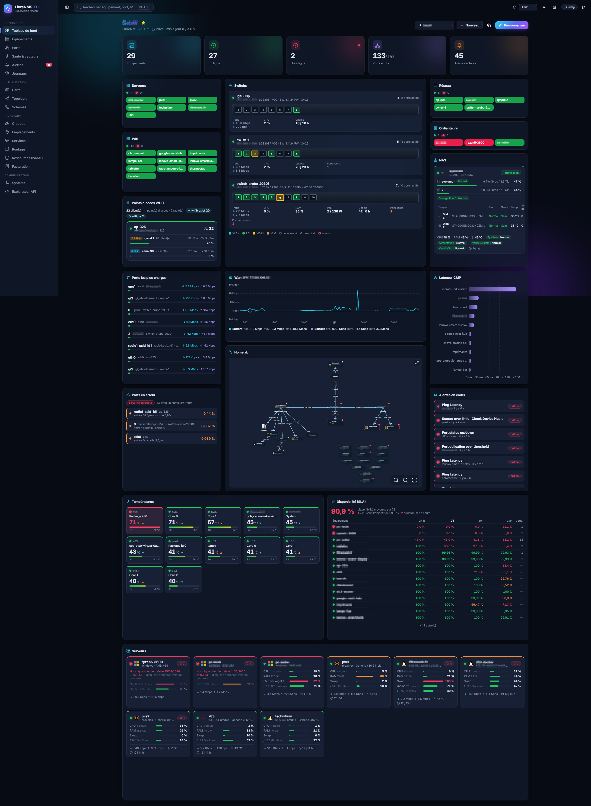
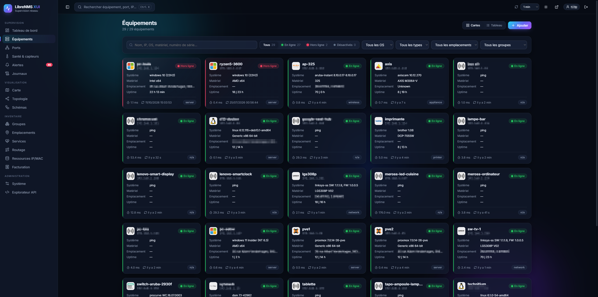
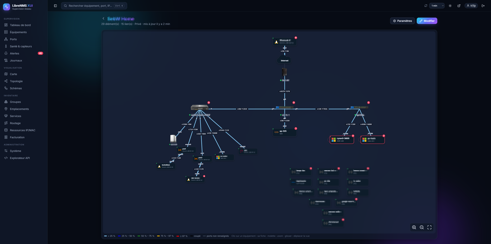
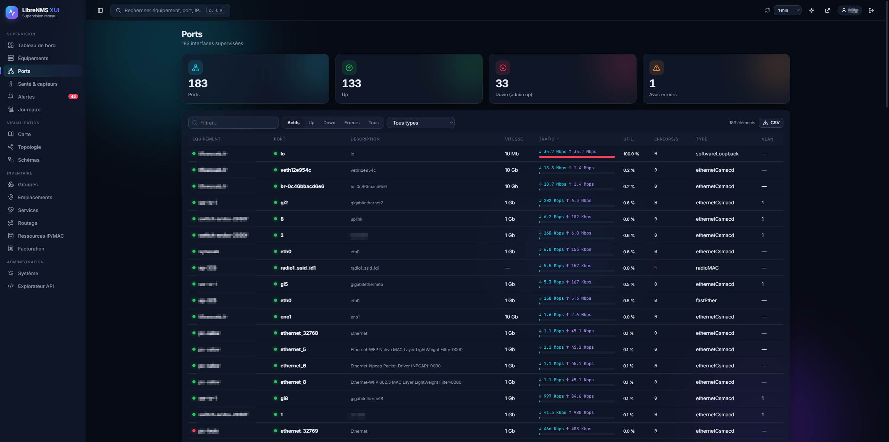
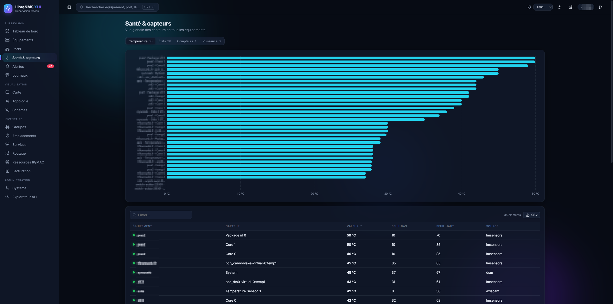
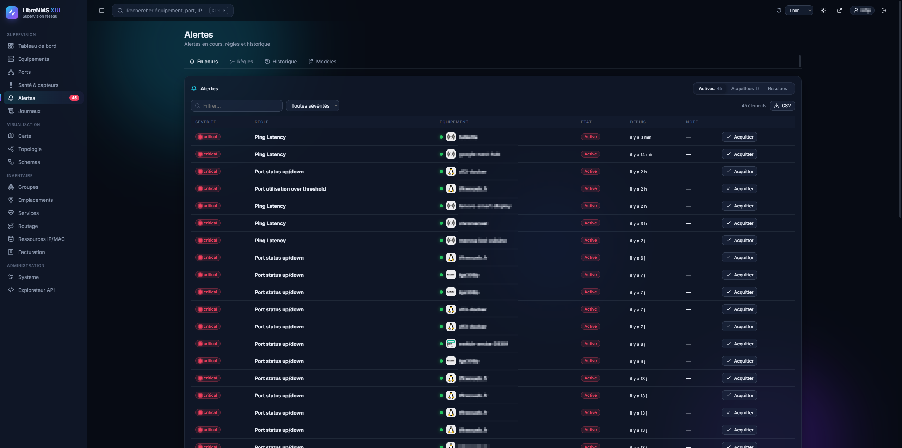
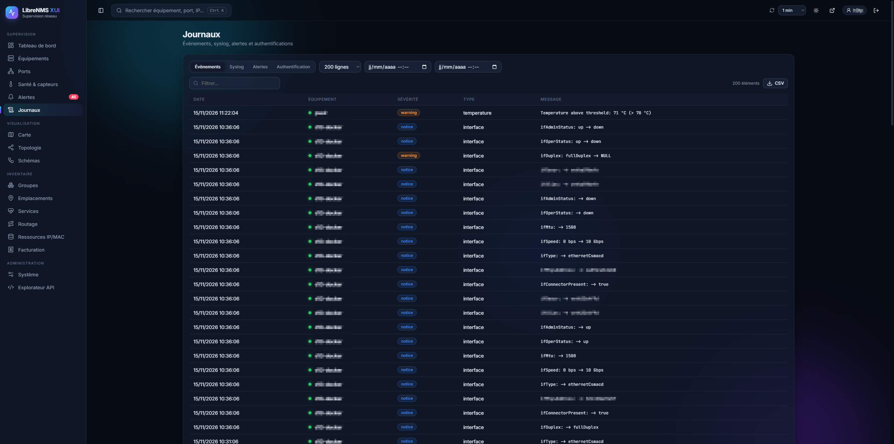
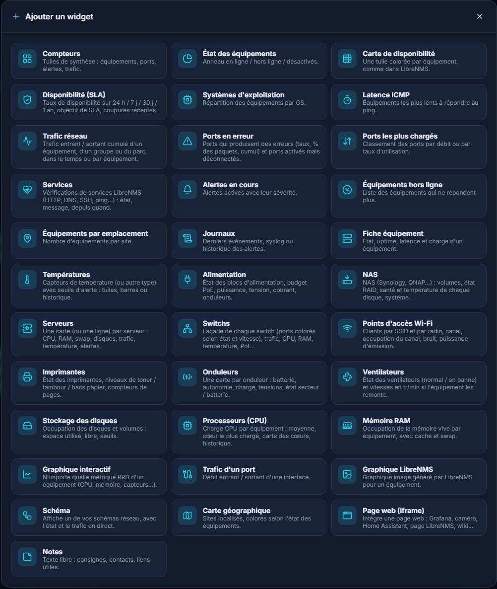

# LibreNMS XUI

**Français** · [English](README.en.md)

**Une interface web moderne pour [LibreNMS](https://www.librenms.org/).**

LibreNMS continue de faire ce qu'il fait bien (découverte, collecte SNMP, alertes) ; XUI propose par-dessus
une interface rapide et claire : tableaux de bord personnalisables, graphiques interactifs, schémas réseau en
direct, thème sombre… Il s'appuie uniquement sur l'**API de LibreNMS** et sur ses **fichiers RRD** (montés en
lecture seule) : rien à modifier ni à installer dans LibreNMS.



## Aperçu

| | |
|---|---|
| **Équipements** : cartes ou tableau, filtres, ajout SNMP / ICMP<br> | **Schémas réseau** : éditeur intégré, liens colorés selon la charge ou le débit<br> |
| **Ports** : trafic, utilisation, erreurs de toutes les interfaces<br> | **Santé & capteurs** : températures, états, compteurs, puissance<br> |
| **Alertes** : en cours, acquittement, règles, historique<br> | **Journaux** : évènements, syslog, alertes, authentification<br> |

<p align="center"><br><em>Plus de 30 widgets pour composer ses tableaux de bord</em></p>

## Points forts

- **Tableaux de bord à la carte** : widgets à glisser et redimensionner (serveurs, switchs avec façade des
  ports, NAS, Wi-Fi, onduleurs, imprimantes, températures, disponibilité / SLA, trafic, schémas, baies…),
  plusieurs tableaux par utilisateur, partage, export / import.
- **Graphiques interactifs** tracés à partir des RRD : zoom, survol, plages de 1 h à 1 an, statistiques.
- **Schémas réseau en direct** : état des équipements, alertes, débits ; liens colorés selon la charge ou le
  débit (couleurs au choix), graphe de trafic et accès aux ports d'un clic, images personnalisées, éléments
  hors LibreNMS (box, caméra…), fond (plan, photo de baie), création depuis LLDP.
- **Baies de brassage** : une ou plusieurs baies par salle, équipements LibreNMS et éléments passifs (panneaux de
  brassage, PDU, étagères…) placés en U par glisser-déposer, façades avec l'état réel des ports, câblage réseau et
  électrique port à port (y compris entre baies et vers les équipements en ping) avec état et trafic en direct, liste
  des câbles exportable.
- **Fiche équipement complète** : vue d'ensemble avec photos, ports, santé, inventaire, voisins CDP/LLDP,
  réseau, routage, services, alertes, journaux, disponibilité, config Oxidized, gestion.
- **Gestion** : ajout / suppression d'équipements, acquittement d'alertes, règles d'alerte avec assistant,
  groupes, emplacements, maintenance.
- **Confort** : interface en français ou en anglais (bouton FR / EN, langue du navigateur par défaut), recherche globale `Ctrl+K`,
  thème clair / sombre, pleine largeur sur les grands écrans, rafraîchissement automatique, export CSV partout.

## Démarrage rapide

Prérequis : Docker avec Compose, une instance LibreNMS accessible et (recommandé) son dossier `rrd`
sur le même hôte.

```bash
git clone https://github.com/h2tp/LibreNMS-XUI.git
cd LibreNMS-XUI
cp .env.example .env      # renseigner au minimum LIBRENMS_URL et RRD_PATH
docker compose up -d --build
```

Interface : `http://<hôte>:8095`

## Configuration

Tout se règle dans `.env` (voir `.env.example`, commenté). Principales variables :

| Variable | Rôle |
|---|---|
| `LIBRENMS_URL` | URL de LibreNMS vue depuis le conteneur |
| `LIBRENMS_PUBLIC_URL` | URL de LibreNMS pour le navigateur (liens « ouvrir dans LibreNMS ») |
| `LIBRENMS_TOKEN` | Jeton API serveur ; vide = chaque utilisateur se connecte avec son propre jeton |
| `UI_AUTH` | `local` (compte unique) ou `librenms` (comptes LibreNMS) |
| `UI_USERNAME` / `UI_PASSWORD` | Compte local (ou de secours en mode `librenms`) |
| `RRD_PATH` | Dossier `rrd` de LibreNMS sur l'hôte (monté en lecture seule) |
| `RRDCACHED` | Adresse de rrdcached si LibreNMS l'utilise (ex. `rrdcached:42217`) |
| `READ_ONLY` | `true` = aucune modification possible depuis XUI |
| `XUI_PORT` | Port publié (8095 par défaut) |
| `COOKIE_SECURE` | `true` derrière un reverse-proxy HTTPS |

### Authentification

| Mode | Configuration | Connexion |
|---|---|---|
| **Jeton personnel** (défaut) | `LIBRENMS_TOKEN` vide | chaque utilisateur colle son jeton API LibreNMS — ses droits LibreNMS s'appliquent |
| **Compte local** | `LIBRENMS_TOKEN` + `UI_PASSWORD` | `UI_USERNAME` / `UI_PASSWORD`, le jeton serveur est utilisé |
| **Comptes LibreNMS** | `LIBRENMS_TOKEN` + `UI_AUTH=librenms` | identifiants LibreNMS (base locale, LDAP, AD…) |
| **Aucune** | `AUTH_DISABLED=true` | réseau de confiance uniquement |

Jeton : LibreNMS › *Paramètres › API › Create API access token*. Un compte **admin** donne accès à
toutes les actions ; un compte *global-read* suffit pour la consultation.

En mode `librenms`, XUI rejoue le formulaire de connexion de LibreNMS et applique le rôle du compte :
`admin` → toutes les fonctions, `global-read` → consultation seule, compte limité à certains équipements
→ refusé. La double authentification n'est pas gérée.

Le jeton ne quitte jamais le serveur (sessions côté serveur, cookie HttpOnly) et les secrets SNMP
(community, mots de passe v3) sont masqués avant d'être envoyés au navigateur.

### Graphiques

Avec le dossier `rrd` monté, les courbes sont tracées à partir des données réelles. Sans montage,
l'interface se rabat sur les images PNG générées par LibreNMS.

## Données et sauvegarde

Ce que XUI stocke lui-même se trouve dans `./data` (volume `/data`) — à inclure dans vos sauvegardes :

| Emplacement | Contenu |
|---|---|
| `dashboards.json` | tableaux de bord |
| `diagrams.json`, `diagram-bg/`, `diagram-img/` | schémas, images de fond, images d'équipements |
| `racks.json` | salles, baies, éléments placés et câbles |
| `device-photos.json`, `device-photos/` | photos des équipements |

<details>
<summary><b>Liste détaillée des fonctionnalités</b></summary>

- **Tableaux de bord** : plusieurs tableaux par utilisateur, widgets à glisser / redimensionner (bouton
  « Personnaliser »), partage privé / lecture / écriture, tableau par défaut (★), duplication, export / import JSON.
  Widgets : compteurs (cartes, tuiles teintées, grands chiffres, jauges, bandeau compact ou liste), état du parc
  (anneau, camembert, demi-anneau, barre empilée, chiffres ou répartition par emplacement / type / OS), carte de disponibilité (tuiles, carrés, hexagones, cartes détaillées, liste ou
  synthèse ; regroupement par emplacement / type / OS, couleur selon l'état ou la latence), OS, latence, ports les plus chargés, alertes,
  équipements hors ligne, emplacements, journaux (évènements / syslog / alertes), fiche équipement,
  températures / capteurs, ventilateurs, alimentation (PSU, PoE), onduleurs, serveurs, NAS (RAID, santé des
  disques), switchs (façade des ports), points d'accès Wi-Fi, imprimantes (consommables lus dans les RRD),
  services LibreNMS, ports en erreur, disponibilité / SLA (24 h à 1 an, coupures), trafic réseau cumulé,
  stockage des disques, mémoire RAM et CPU, graphique RRD interactif, trafic d'un port, graphique LibreNMS,
  carte géographique, schéma, baie (une baie ou toute une salle, ajustée à la taille du widget, fenêtre de trafic
  au survol des câbles, légende des couleurs, clic sur le nom d'une baie pour ouvrir sa salle), notes,
  page web (iframe sandboxée).
  Les données agrégées (CPU, RAM, stockage, disponibilité, Wi-Fi, imprimantes) sont préchauffées au démarrage
  puis servies depuis un cache rafraîchi en arrière-plan ; `AGG_CONCURRENCY` (6 par défaut) limite les
  requêtes simultanées vers LibreNMS. Le propriétaire d'un tableau est le nom d'utilisateur de la session XUI :
  en mode « jeton », c'est le nom saisi à la connexion (rangement, pas un contrôle d'accès fort).
- **Schémas réseau** (Visualisation › Schémas) : équipements glissés depuis une liste, liens entre deux éléments
  avec choix des ports (pré-remplis par LLDP), nuages et textes libres, **éléments libres** absents de LibreNMS
  (box opérateur, caméra, équipement non supervisé… : nom, sous-titre, image ; sans état ni alertes, le trafic
  d'un lien vers un équipement est lu sur le port côté équipement), liens courbables, fond uni / grille /
  image (PNG, JPEG, WebP, GIF, 8 Mo max.), annuler / rétablir, export SVG. En direct : état des équipements,
  alertes, débits, couleur et épaisseur des liens selon la charge (%) ou le débit, avec paliers et couleurs
  personnalisables par schéma (par défaut, charge : bleu clair < 1 %, bleu < 10 %, vert < 40 %, ambre < 70 %,
  rouge au-delà, noir si coupé). Survol d'un lien : graphe de trafic 24 h ; clic : fenêtre épinglée avec liens
  vers les fiches des ports. Image personnalisée par équipement ou élément (dans la carte ou à la place de la carte),
  bibliothèque d'images partagée. Création depuis la topologie LLDP (disposition en arbre). Partage comme les
  tableaux de bord.
- **Baies** (Visualisation › Baies) : salles contenant une ou plusieurs baies (4 à 48 U) affichées côte à côte ;
  équipements LibreNMS et éléments passifs (panneaux de brassage 12/24/48 ports, PDU, étagère, passe-câbles, obturateur,
  élément libre) glissés en U, déplacement entre baies, hauteur et nombre de prises réglables, façade dessinée à partir
  des ports réels (vitesse, état, erreurs, trafic au survol) ou photo de façade. Prises d'alimentation sur les
  équipements (0 à 4) pour câbler les PDU ; ports réseau virtuels pour les équipements sans port physique (supervisés
  par ping), dont l'état suit la joignabilité, et pour les éléments libres absents de LibreNMS. Câblage port à port en deux clics,
  y compris entre baies et vers les panneaux de brassage : couleur, type (cuivre, fibre, DAC, alimentation), longueur,
  étiquette ; câbles affichés selon leur couleur ou leur état / charge (paliers et couleurs réglables par salle, comme
  pour les schémas, avec légende), fenêtre de trafic au survol, liste des câbles
  exportable en CSV. Câbles déplaçables (forme libre) et rebranchables en glissant leurs extrémités.
  Annuler / rétablir (Ctrl+Z / Ctrl+Y). Partage comme les schémas. Stockage : `./data/racks.json`.
- **Équipements** : cartes / tableau, filtres (état, OS, type, emplacement, groupe), ajout SNMP v1/v2c/v3 ou ICMP.
- **Fiche équipement** : vue d'ensemble (jauges CPU / RAM / disque / dispo, photos avec légendes et plein écran,
  emplacement dans les baies avec extrait de la baie et liste des câbles),
  ports avec sparklines, santé (processeurs, mémoire, stockage, capteurs + graphiques), explorateur de tous les
  RRD, inventaire ENTITY-MIB en arbre, voisins CDP/LLDP (graphe), IP, VLAN, FDB, ARP, pile de ports,
  transceivers, BGP / OSPF / VRF / IPsec, services, alertes, journaux, disponibilité & coupures, composants,
  config Oxidized, gestion (propriétés, maintenance, renommage, redécouverte, suppression).
- **Port** : trafic, paquets, broadcast / multicast, erreurs, avec 4 graphiques côte à côte (24 h, 7 j, 30 j, 1 an)
  comme dans LibreNMS — un clic affiche la période en grand ; IP, MAC apprises, édition de la description.
- **Ports / Santé** globaux, **Alertes** (acquittement, règles avec assistant, historique, modèles).
- **Journaux** : évènements, syslog, alertes, authentification (filtres de dates, export CSV).
- **Carte** géographique, **Topologie** colorée selon la charge des liens.
- **Groupes**, **Emplacements** (placement par clic / glisser sur la carte), **Services**, **Routage**,
  **Ressources** IP / ARP / FDB / VLAN, **Facturation**, **Système**, **Explorateur API**.

</details>

## Technique

- **Frontend** : Vue 3, Vite, ECharts, Leaflet, Lucide
- **Backend** : FastAPI (Python) — proxy de l'API LibreNMS, lecture des RRD via `rrdtool`, sessions et stockage local
- **Déploiement** : une seule image Docker (build multi-étapes), utilisateur non root, healthcheck
